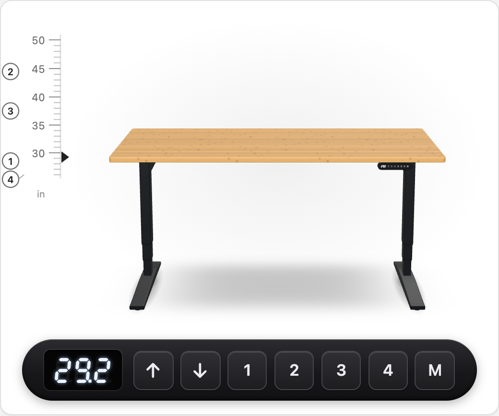
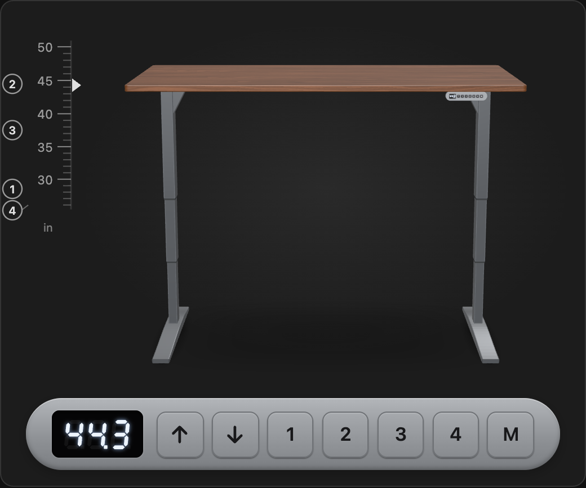
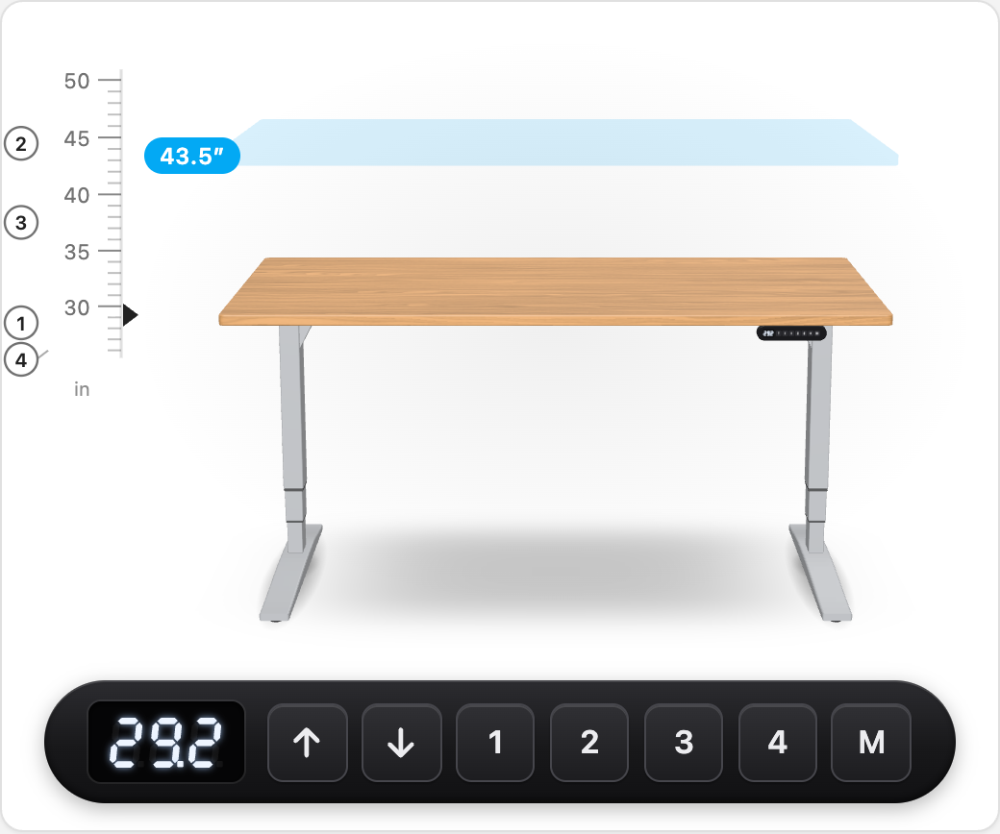
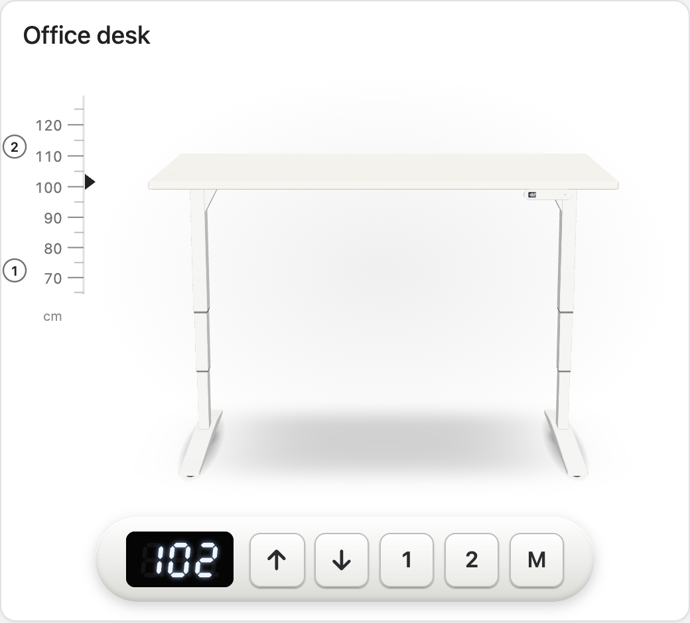

# Standing Desk Card

A Home Assistant dashboard card that shows your standing desk as a real-time 3D model and controls it through a [DeskUp Pro (RJ12) ESPHome controller](https://github.com/kedube/DeskUp-Pro-Controller-RJ12). The model follows the UPLIFT V2 2-leg frame, and the controls work like the UPLIFT Advanced keypad.

<p align="center">
  
  
</p>

## Features

- **A 3D desk that moves with yours.** The 3-stage legs telescope as the desk rises, and the motion is smoothed to the desk's real speed between Home Assistant updates.
- **The keypad you know.** A copy of the Advanced keypad: live height display, ▲/▼, memory presets and M.
- **Exact heights.** Drag the height scale beside the desk and an outline shows where the desktop will stop. Or tap the display and type a height.
- **2, 3 or 4 memory presets**, to match your controller.
- **Your desk's colors.** Desktop presets (bamboo, walnut, oak and more) or any color with a laminate, wood-grain or bamboo surface. Frame in black, white, gray, industrial or any color.
- **Inches or centimeters**, following Home Assistant's unit system by default.
- **Visual editor** for every option.

<p align="center">
  
  
</p>

## Requirements

- A DeskUp Pro (RJ12) controller running the [DeskUp Pro firmware](https://github.com/kedube/DeskUp-Pro-Controller-RJ12), added to Home Assistant through the ESPHome integration.
- Home Assistant 2024.1 or later.
- A browser with WebGL. Without it, the keypad still works but the 3D view is hidden.

## Installation

### HACS

1. In HACS, open the menu (⋮) and choose **Custom repositories**.
2. Add `https://github.com/kedube/ha-standing-desk-card` with the type **Dashboard**.
3. Install **Standing Desk Card**, then reload your browser.

### Manual

1. Download `standing-desk-card.js` from the [latest release](https://github.com/kedube/ha-standing-desk-card/releases).
2. Copy it to `/config/www/`.
3. Go to **Settings → Dashboards → ⋮ → Resources** and add `/local/standing-desk-card.js` as a **JavaScript module**.

## Configuration

Add the card from the dashboard editor (search for "Standing Desk") and pick your controller, or use YAML:

```yaml
type: custom:standing-desk-card
presets: 4
desktop_color: bamboo
frame_color: black
```

With no `device`, the card uses the first DeskUp Pro it finds.

| Option | Default | Description |
| --- | --- | --- |
| `device` | First DeskUp Pro found | Device ID of the controller. |
| `presets` | `4` | Memory presets your controller supports: `2`, `3` or `4`. |
| `name` | — | Title shown above the desk. |
| `unit` | `auto` | `auto` (follows Home Assistant's unit system), `in` or `cm`. |
| `desktop_color` | `bamboo` | `bamboo`, `dark-bamboo`, `walnut`, `oak`, `maple`, `rubberwood`, `cherry`, `white`, `gray`, `black`, or a hex color such as `"#2f5d50"`. |
| `desktop_finish` | From the preset | Surface for hex colors: `laminate`, `wood` or `bamboo`. |
| `desktop_width` | `60` | Width in inches, or with a unit: `"152cm"`. |
| `desktop_depth` | `30` | Depth in inches, or with a unit. Depths under 27″ use UPLIFT's shorter feet. |
| `desktop_thickness` | `1` | Thickness in inches, or with a unit. |
| `frame_color` | `black` | `black`, `white`, `gray`, `industrial`, or a hex color. |
| `frame_finish` | From the preset | `powder` (powder coat) or `metallic`. |
| `keypad_color` | `black` | `black`, `white` or `gray`. |
| `keypad_side` | `right` | Which end of the desk the keypad is mounted on. |
| `show_scale` | `true` | Show the draggable height scale. |
| `allow_preset_save` | `true` | Allow saving presets with M. Turn it off to stop presets from being overwritten from the dashboard. |
| `show_idle` | `false` | Show the controller's idle timer under the keypad. |
| `hold_repeat_ms` | `250` | How often a nudge is sent while ▲/▼ is held. |
| `entities` | — | Per-role entity overrides (see below). |

### Entity overrides

The card finds the controller's entities by their names. If you renamed any entity IDs, map them under `entities`:

```yaml
type: custom:standing-desk-card
entities:
  height: number.office_desk_height
  stop: button.office_desk_stop
```

| Role | DeskUp Pro entity |
| --- | --- |
| `height` | Desk Height (number; this is how exact heights are set) |
| `height_sensor` | Desk Height (sensor; used if the number is missing) |
| `status` | Desk Status (Raising / Lowering / Idle) |
| `nudge_up`, `nudge_down`, `stop` | Desk Nudge Up, Desk Nudge Down, Desk Stop |
| `min_height`, `max_height` | Min Height, Max Height (these set the scale's range) |
| `preset_1` … `preset_4` | Desk M1 … Desk M4 |
| `save_preset_1` … `save_preset_4` | Set Desk M1 … Set Desk M4 |
| `preset_1_height` … `preset_4_height` | Desk M1 Height … Desk M4 Height |
| `idle_time` | Idle Time |

## Using the card

| Control | What it does |
| --- | --- |
| ▲ / ▼ tap | Nudges the desk (about 1 cm). |
| ▲ / ▼ hold | Keeps sending nudges, then Stop when you let go. If the connection drops mid-hold, the nudges stop arriving and the desk stops by itself. |
| 1–4 | Moves to that memory preset. |
| M, then 1–4 | Saves the current height to that preset (within 4 seconds). The display shows `S-` and then `S-1`, like the real keypad. |
| Any key while the desk is moving to a preset or target | Stops the desk. |
| Tap the display | Type a height and press **Go**. |
| Drag (or tap) the height scale | Pick a height. An outline shows where the desktop will stop, and the desk moves when you let go. With the keyboard, focus the scale, use the arrow keys, Page Up/Down or Home/End, then press Enter. |
| Numbered markers on the scale | Show where your presets are. Tap one to go there. |

## Tips

- **Set the travel range.** The scale runs between the controller's **Min Height** and **Max Height** settings. For an UPLIFT V2 with a 1″ desktop, the physical range is 25.3–50.9″ (64.3–129.3 cm).
- **Presets only nudge the desk?** UPLIFT control boxes can be set to Constant-Touch memory mode, where a preset only moves the desk while the button is held. Switch to One-Touch mode using UPLIFT's [control box programming guide](https://checkout.upliftdesk.com/content/Programming-UPLIFT-Control-Box-R01.pdf).
- **Height off by a millimetre or two?** Adjust **Offset Up by** and **Offset Down by** in the controller's configuration.

## Development

```sh
npm install
npm run dev     # opens dev/index.html with a simulated DeskUp Pro
npm test
npm run build   # writes dist/standing-desk-card.js
```

The dev page simulates the controller's entities and an UPLIFT V2's travel speed, so you can try every control without a desk.

### Releasing

Run the **Release** workflow from the Actions tab on `main`. It tests and builds the card, then publishes the next version with `standing-desk-card.js` attached. Versions count up in hundredths with no "v" prefix: 0.01, 0.02 … 0.99, then 1.00, 1.01 and so on.

## Credits

The desk's dimensions come from UPLIFT's published V2 frame and keypad spec sheets. This project isn't affiliated with UPLIFT Desk or SmartHomeGuys, and it uses no UPLIFT artwork or logos.

## License

[GPL-3.0](LICENSE)
